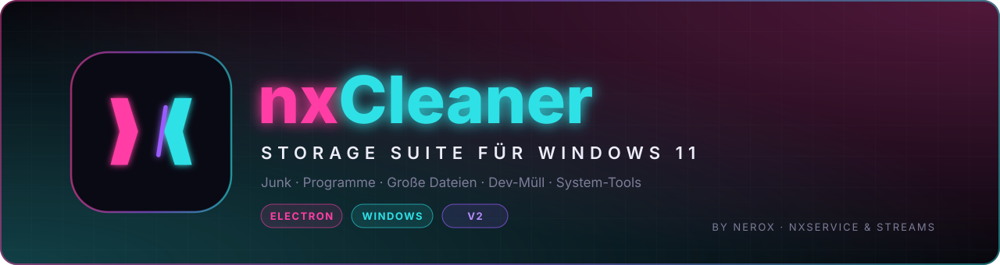
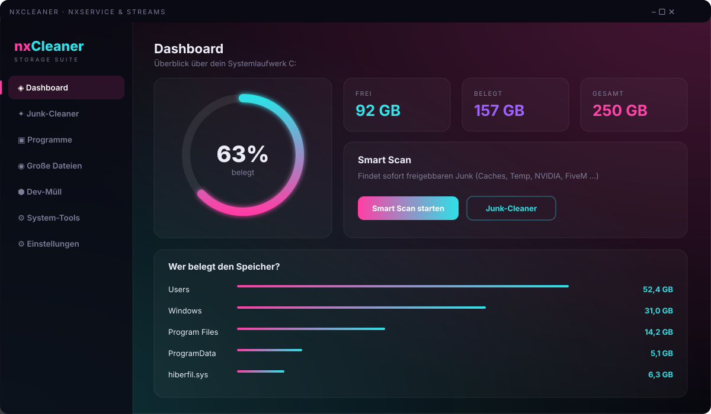

<div align="center">



<br>


**Räumt dein C:-Laufwerk auf – Junk, Caches, ungenutzte Programme, Dev-Müll und Systemballast.**


</div>

## ✦ Vorschau

<div align="center">

</div>


## ◈ Features

| Bereich | Was es macht |
| --- | --- |
| **◈ Dashboard** | Belegung von C: als Ring, freier/belegter/gesamter Speicher, **Smart Scan** und Speicher-Analyse der größten Ordner |
| **✦ Junk-Cleaner** | Scannt Caches und Reste, zeigt Größen pro Kategorie, Bereinigung per Klick |
| **▣ Programme** | Listet ungenutzte Programme (≥ 90 / 180 / 365 Tage), deinstalliert und findet **übrig gebliebene Ordner** |
| **◉ Große Dateien** | Dateien ≥ 200 MB in deinem Profil und eigenen C:-Ordnern |
| **⬢ Dev-Müll** | Findet `node_modules`-Ordner deiner Projekte (per `npm install` wiederherstellbar) |
| **⚙ System-Tools** | Ruhezustand aus (`hiberfil.sys`), Schattenkopien löschen, `Windows.old` entfernen, Komponentenspeicher (DISM) |
| **⚙ Einstellungen** | Ausschlüsse, geplante Bereinigung, Verlauf |

### Junk-Kategorien

| Kategorie | Inhalt |
| --- | --- |
| Temp | User- und Windows-Temp |
| Windows Update | Update-Download-Cache, Delivery Optimization |
| Crash Dumps | Minidumps, Fehlerberichte (WER) |
| Logs | CBS- und DISM-Logs |
| Shader | DirectX- und AMD-Shader-Cache |
| **NVIDIA** | DXCache, GLCache, NV_Cache, Downloader, Installer-Reste (`C:\NVIDIA`) |
| Browser | Chrome, Edge, Brave, Firefox |
| Discord | Cache, Code Cache, GPU Cache |
| **FiveM** | `data/cache`, `server-cache`, `server-cache-priv`, Logs, Crashes |
| Dev | npm, pip, Yarn, Electron, electron-builder |
| Extras | Papierkorb leeren, Komponentenspeicher (DISM) |

### Weitere Funktionen

- **Ausschlüsse:** Ordner, die der Junk-Cleaner nie anfasst.
- **Geplante Bereinigung:** Täglich oder wöchentlich zur gewählten Uhrzeit über die Windows-Aufgabenplanung (`nxCleaner Scheduled Cleanup`). Zeitgesteuert laufen nur die sicheren Kategorien: Temp, Shader, NVIDIA, Browser, Discord, FiveM und Dev.
- **Laufende Programme:** Läuft Browser, Discord oder FiveM, weist dich nxCleaner vor der Bereinigung darauf hin.
- **Fortschritt und Abbrechen:** Lange Vorgänge zeigen einen Fortschrittsbalken und lassen sich abbrechen.
- **Verlauf:** Die letzten 100 Aktionen mit freigegebenem Speicher.


## ▣ Installation

### Entwicklung

```bash
git clone <dein-repo> nxCleaner
cd nxCleaner
npm install
npm start
```

Alternativ `start.bat` doppelklicken. Die Datei holt sich Administratorrechte, installiert beim ersten Start die Abhängigkeiten und startet die App.

### Installer bauen

```bash
npm run dist
```

Der NSIS-Installer landet in `dist/`. Er installiert für alle Benutzer, lässt das Zielverzeichnis wählen und startet die App immer mit Administratorrechten (`requireAdministrator`).

## ⬢ Projektstruktur

```
nxCleaner/
├─ main.js          Electron-Hauptprozess: Scans, Bereinigung, Deinstallation, Zeitplan, Verlauf
├─ preload.js       Sichere Brücke zwischen UI und Hauptprozess (contextBridge)
├─ index.html       Oberfläche
├─ renderer.js      UI-Logik
├─ style.css        nx-Neon-Design
├─ start.bat        Dev-Start mit Admin-Rechten
├─ build/           App-Icon (icon.ico, icon_source.png)
└─ assets/          Logo, Banner, Vorschau
```

Einstellungen, Ausschlüsse, Zeitplan und Verlauf liegen als `settings.json` im Electron-`userData`-Ordner.

## ⚙ Design

| Farbe | Hex | Verwendung |
| --- | --- | --- |
| Pink | `#ff3ea5` | Hauptakzent, Buttons, aktive Navigation |
| Cyan | `#2de1e6` | Sekundärakzent, Größenangaben, Outline-Buttons |
| Violett | `#9b5cff` | Verlauf, Slash im Logo |
| Hintergrund | `#07070d` | App-Hintergrund |

## ⚠ Wichtige Hinweise

- **Löschen ist endgültig.** Große Dateien, Dev-Müll, Windows.old und Schattenkopien gehen nicht in den Papierkorb.
- **Programm-Nutzung ist eine Schätzung.** Das Datum stammt aus den Windows-Prefetch-Daten. Ist Prefetch deaktiviert (z. B. bei debloateten Windows-Versionen), steht dort „unbekannt" oder „ungenau". Dann vor dem Deinstallieren selbst prüfen.
- **System-Tools sind tiefe Eingriffe.** Ruhezustand aus deaktiviert auch den Schnellstart, Schattenkopien weg bedeutet keine alten Wiederherstellungspunkte, nach Windows.old gibt es kein Rollback.
- **Treiber und Laufzeiten** (NVIDIA-Treiber, Visual C++, .NET, WebView2) werden in der Programmliste ausgeblendet.


<div align="center">

<br>
<sub>© NeroX · <b>nxService &amp; Streams</b></sub>
</div>
